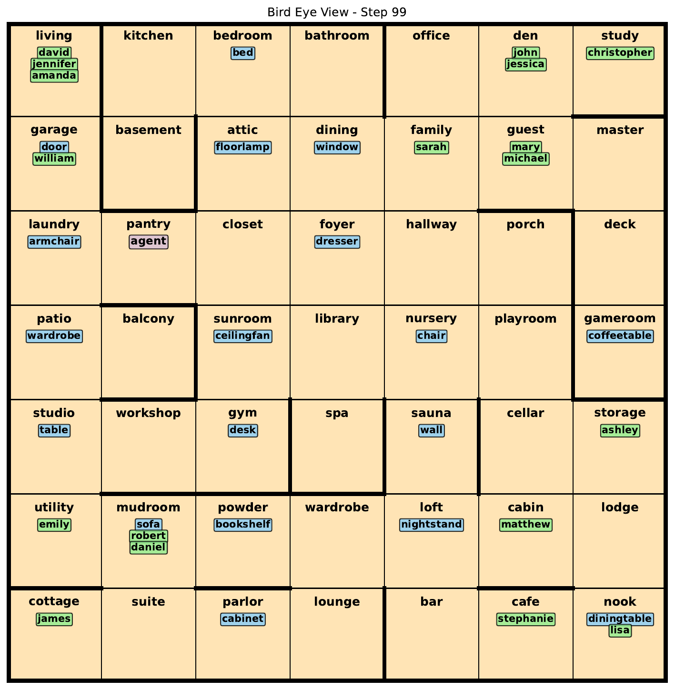
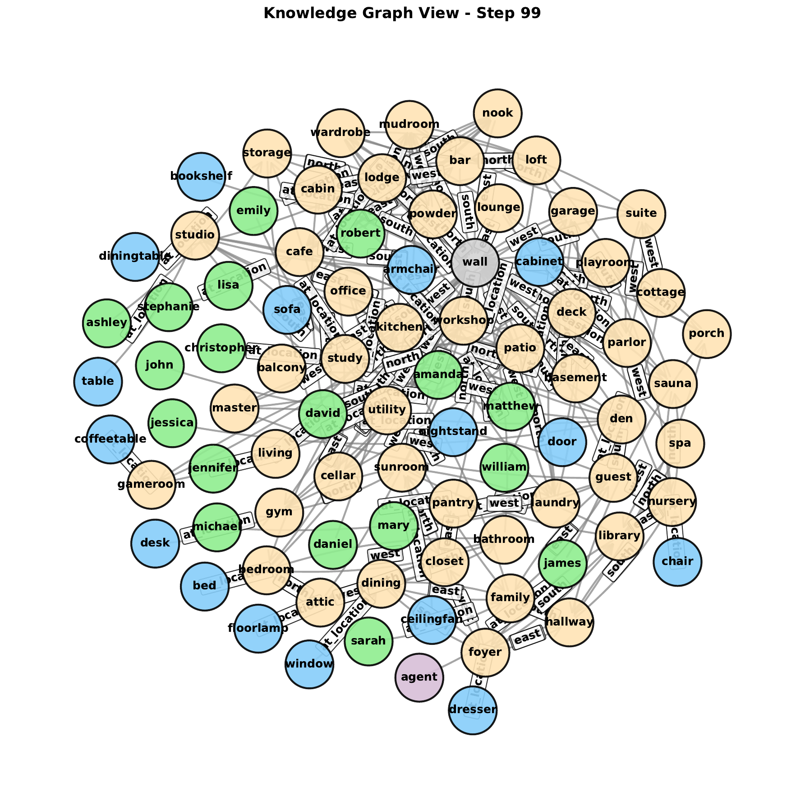
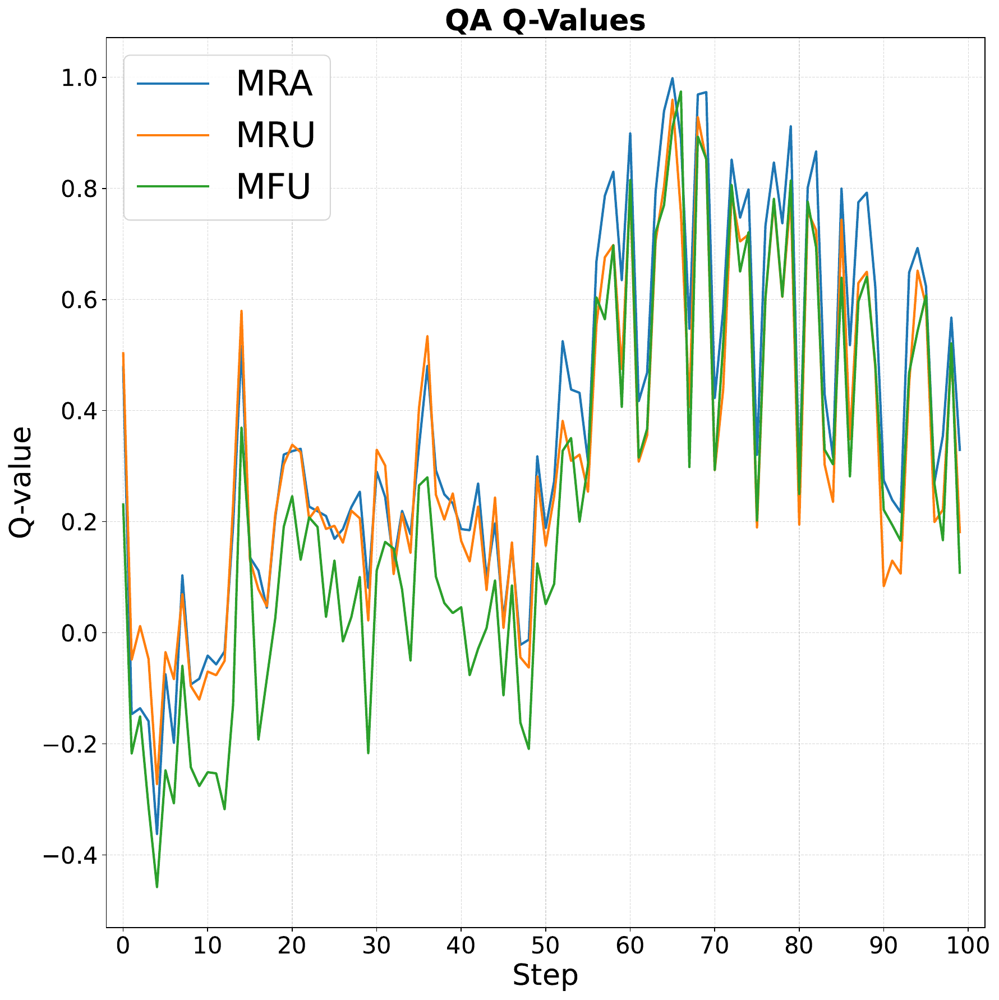
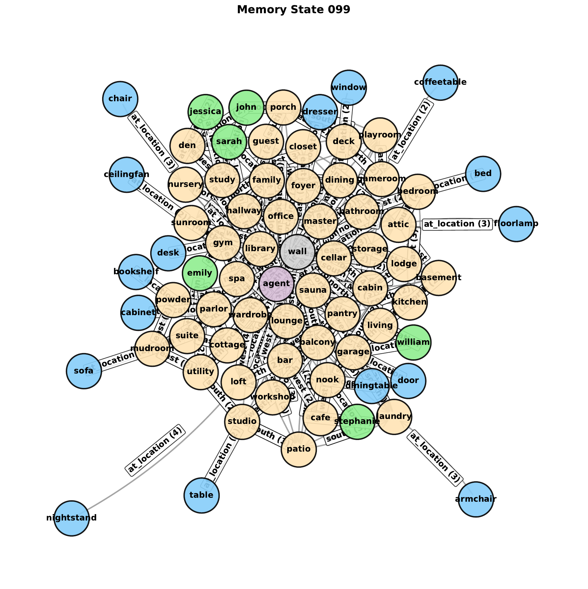

# RoomKG Meta-Policies

**Authors:** [Taewoon Kim](https://taewoon.kim/), [Vincent Francois-Lavet](http://vincent.francois-l.be/), and [Michael Cochez](https://www.cochez.nl/).

Code for the neuro-symbolic meta-policies that learn *which* symbolic memory
heuristic to apply — for question answering, exploration, and forgetting — over a
temporal knowledge-graph memory in
[RoomEnv-v3](https://github.com/humemai/room-env), the RoomKG benchmark.

This is the code for the paper *"Neuro-Symbolic Meta-Policies for Temporal
Knowledge-Graph Memory under Partial Observability"*, accepted at the
[ISWC 2026](https://iswc2026.semanticweb.org/) Research Track. For the research
overview, see the [project page](https://humem.ai/projects/roomkg-meta-policies).

This README focuses on the code, experiment entry points, evaluation flow, and
reproduced figures in this repository.

## Repository layout

- [`agent/`](./agent): symbolic agents, the neuro-symbolic DQN controller, and shared neural modules
- [`run-dqn.py`](./run-dqn.py): train the proposed neuro-symbolic meta-policy agent (GCN, R-GCN, StarE-GNN, and Transformer encoders)
- [`run-dqn-test.py`](./run-dqn-test.py): evaluate completed neuro-symbolic runs on held-out environments
- [`run-symbolic.py`](./run-symbolic.py): symbolic temporal knowledge-graph baselines (fixed heuristic combinations)
- [`run-symbolic-simple.py`](./run-symbolic-simple.py): plain-RDF symbolic baseline sweep
- [`run-dqn-simple.py`](./run-dqn-simple.py): train sequence-based neural baselines (LSTM and Transformer)
- [`run-dqn-simple-test.py`](./run-dqn-simple-test.py): evaluate completed sequence baselines on held-out environments
- [`plot-symbolic.py`](./plot-symbolic.py), [`plot-symbolic-simple.py`](./plot-symbolic-simple.py), [`plot-dqn.py`](./plot-dqn.py), and [`plot-dqn-simple.py`](./plot-dqn-simple.py): aggregate experiment outputs into paper figures
- [`plot-results.py`](./plot-results.py): render memory-state graphs from saved test-time state traces
- [`figures/`](./figures): README figures exported from the paper

## Method overview

The agent's memory is an RDF graph whose facts carry temporal annotations
(`time_added`, `last_accessed`, `num_recalled`). Instead of learning low-level
actions end to end, a learned meta-policy selects among *named symbolic
heuristics* at each decision point, so execution stays symbolic and inspectable:

- **QA head**: choose among `MRA`, `MRU`, `MFU` retrieval heuristics
- **Explore head**: choose among `MRA`, `MRU`, `MFU` exploration rankings
- **Forget head**: choose among `LRU`, `LFU`, `FIFO` eviction heuristics

Memory contents are encoded with a graph encoder — topology-only GCN,
relation-aware R-GCN, or qualifier-aware StarE-GNN — and each policy head reads a
policy-specific attention pooling of the memory embeddings.

## Prerequisites

1. Python 3.10 or higher
1. A virtual environment is recommended
1. Install the requirements with `pip install -r requirements.txt`

## Run experiments

Run the symbolic temporal knowledge-graph baselines:

```sh
python run-symbolic.py --workers 4
```

Run the plain-RDF symbolic baseline sweep:

```sh
python run-symbolic-simple.py --workers 4
```

Train the neuro-symbolic meta-policy agents:

```sh
python run-dqn.py --workers 4
```

Evaluate completed neuro-symbolic runs on the held-out environment:

```sh
python run-dqn-test.py --env large-02-q --workers 1
```

Train the sequence-based neural baselines on one environment configuration:

```sh
python run-dqn-simple.py --env large-02 --workers 4
```

Evaluate completed sequence baselines on the held-out environment:

```sh
python run-dqn-simple-test.py --env large-02-q --workers 1
```

The symbolic scripts write results under `training-results-symbolic/` and
`training-results-symbolic-simple/`. Neuro-symbolic runs write outputs under
`training-results-dqn/`, and sequence baselines write outputs under
`training-results-simple-dqn/`.

## Paper setup

- **Environments**: `large-02` for training and `large-02-q` (permuted question
  order) for held-out testing, with 100-step episodes
- **Long-term memory capacity**: the main comparison is at capacity 512
- **Method families**: fixed symbolic heuristic combinations, end-to-end neural
  sequence baselines, and the proposed neuro-symbolic meta-policy
- **Encoders**: GCN, R-GCN, and StarE-GNN, plus shared-network and combinatorial
  action-head ablations
- **Seeds**: learned runs use seeds `0, 5, 10, 15, 20`; results report mean and
  standard deviation

## Plotting and analysis

Aggregate the paper plots after experiments finish:

```sh
python plot-symbolic.py
python plot-dqn.py
python plot-dqn-simple.py
```

Render step-level memory-state graphs from a saved test trace:

```sh
python plot-results.py --states training-results-dqn/<run>/states_q_values_actions_test.yaml
```

Replace `<run>` with the experiment directory produced by `run-dqn-test.py`.

## Results

| Hidden-state view | Knowledge-graph view |
| :---------------: | :------------------: |
|  |  |

| Learned QA-head Q-values over an episode |
| :--------------------------------------: |
|  |

| Final symbolic memory state under the learned meta-policy |
| :-------------------------------------------------------: |
|  |

At long-term memory capacity 512, the qualifier-aware StarE-GNN configuration
achieves the best held-out performance among the compared symbolic, neural, and
neuro-symbolic systems, while every memory-management decision remains traceable
to a named symbolic heuristic.

## Further reading

- [Project page](https://humem.ai/projects/roomkg-meta-policies)
- [RoomEnv-v3 / RoomKG benchmark](https://github.com/humemai/room-env)

## Cite our paper

```bibtex
@inproceedings{kim2026neurosymbolicmetapolicies,
      title={Neuro-Symbolic Meta-Policies for Temporal Knowledge-Graph Memory under Partial Observability},
      author={Taewoon Kim and Vincent Fran\c{c}ois-Lavet and Michael Cochez},
      booktitle={The Semantic Web -- ISWC 2026},
      year={2026},
      publisher={Springer},
      note={To appear},
}
```
